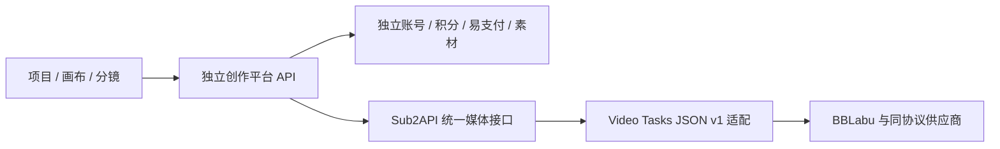

# 媒体网关与独立创作平台设计总览

日期：2026-10-17。状态：设计稿，业务代码尚未实施；本地基线 `feat/my-sub` / `03c3c50cc`。

## 已确认需求

1. 标准化支持 BBLabu 全部视频型号，获取上游模型，支持按视频条数收费；允许同协议供应商自定义名称和 URL。
2. 确定 Sub2API 对外稳定的视频接口，作为独立图片/视频平台的供应接口。
3. 新平台面向专业设计与视频创作，以项目、画布、分镜和素材为主；账号、积分、充值订单完全独立，支持易支付，生成只走 Sub2API。
4. 用户明确缩小范围：单账号、单钱包，可以共用账号；不建设成员邀请、工作空间、团队角色、预算或付款人体系。

## 三份交付与依赖

| 顺序 | 设计 | 本次状态 | 实施边界 |
| --- | --- | --- | --- |
| 1 | [通用视频任务协议与计费](D:/Code/Other/sub2api/docs/superpowers/specs/2026-10-17-video-tasks-json-v1-design.md) | 代码核查后的改造设计 | 当前 Sub2API 后端与管理端 |
| 2 | [对外媒体契约](D:/Code/Other/sub2api/docs/superpowers/specs/2026-10-17-public-media-contract.md) | 明确区分当前接口和计划扩展 | 保持现有客户端兼容 |
| 3 | [独立创作平台 PRD](D:/Code/Other/sub2api/docs/superpowers/specs/2026-10-17-creative-platform-prd.md) | 按单账号范围编写 | 独立仓库、数据库和部署 |

先完成第 1 项并验证第 2 项，再按第 3 项建设创作平台。不在 Sub2API 管理端内复制一套创作业务。

## 关键决策

- 协议建议名为 **Video Tasks JSON v1**，标识 `video_tasks_json_v1`。这是本项目的兼容协议名称，不宣称行业官方标准，也不等同于 OpenAI 的所有 Videos 接口。
- 供应商名称、Base URL、Key 与协议分离；BBLabu 是供应商预设。旧 `bblabu_v1` / `fflink_v1` 继续兼容。
- 模型发现、参数能力、价格分别管理。`GET /v1/models` 返回型号不代表已验证可生成、可计价或可上架。
- 按条与按秒分别计价并冻结快照；不改变旧字段的单位，也不自动把历史 per_request 行变为新销售价。
- 新任务使用网关 ID，避免不同供应商的任务编号碰撞；旧任务仍可沿原 ID 查询。
- 图片复用标准 Images 链路，但现有六款 BBLabu 型号的本地准入仍须补齐，不能写成已经全部可用。
- 画布节点是任务/素材引用；节点编辑和删除不触发付费、不取消任务、不退款。

## 设计工作记录

- [x] 阅读项目约束、现有方案、上游目录及审计结果。
- [x] 按最新用户意见收缩为单账号、单钱包。
- [x] 比较实施方式并写出三份设计。
- [x] 独立规格审查通过；已补齐未知输出时长的计量和预占边界。
- [ ] 用户审阅具体设计后进入实现。

本轮不发布、不改价格、不创建付费任务。品牌、域名、实际易支付商户参数、零售价和媒体保留期属于部署配置，上线前必须填写并验证。
